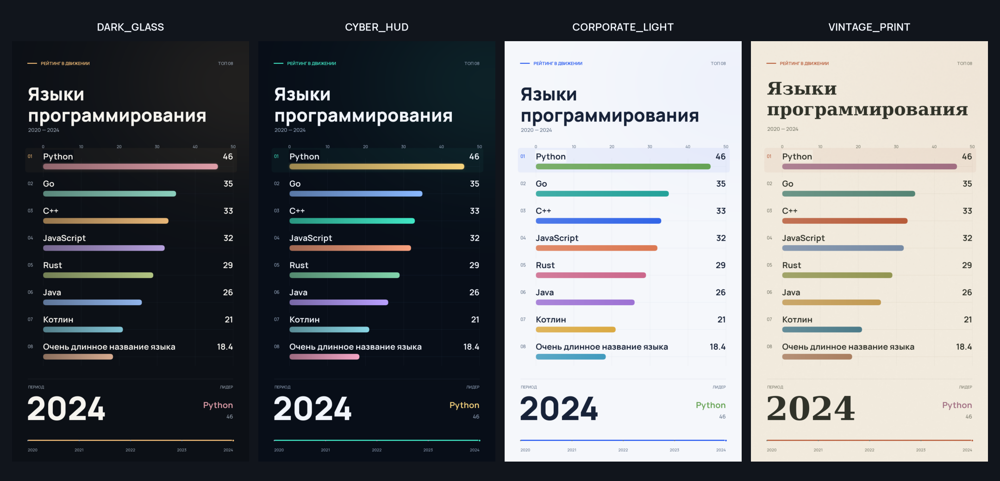
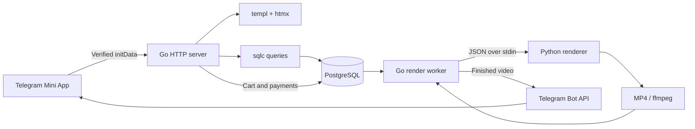

# CONTGEN

**Turn a CSV into a vertical animated video, directly in Telegram.**

[](https://github.com/smirnoffff/contgen/actions/workflows/checks.yml)
[](https://go.dev/)
[](https://www.postgresql.org/)
[](https://core.telegram.org/bots/webapps)

[Русская документация](docs/README.ru.md) · [Setup](#run-locally) · [Architecture](#architecture) · [Tests](#checks-and-development) · [Security](SECURITY.md)

CONTGEN is a Telegram Mini App for creating **1080 × 1920 bar chart race videos**. Upload a dataset, choose a theme and music, then receive the finished MP4 from the bot. The app includes a cart, a PostgreSQL-backed rendering queue, Telegram Stars payments, and an optional AdsGram rewarded-ad flow.



*Frames from the actual renderer. The programming-language values are illustrative demo data.*

## What it does

| From data to video | Inside the app |
| --- | --- |
| CSV upload with validation and a reusable dataset library | Telegram authentication and user-scoped datasets and orders |
| Four themes, animated rankings, optional music | Multiple videos per cart and per-user order numbers |
| 3–60 second vertical H.264 videos | Telegram Stars and optional rewarded-ad payments |
| HTML preview before rendering | Queue status, delivery to Telegram, and a delivery retry action |
| Shared and personal music and datasets | Admin tools, promo codes, and a 20-locale picker with English fallback |

This is a personal and university project, developed and tested locally. It is not presented as a hosted production service. Payment and advertising integrations require your own provider setup.

## Architecture



The Go server handles authentication, HTTP endpoints, checkout, and delivery. `templ` generates HTML components; htmx updates individual page fragments. PostgreSQL stores the durable application state, and sqlc generates typed queries.

Rendering runs in a separate Python subprocess. Requests and results stay small: structured JSON goes in, a video file comes out. Go applies timeouts, cancels child processes, and publishes completed files with an atomic rename. The serial worker uses a PostgreSQL advisory lock and recovers interrupted jobs when it reconnects. Delivery errors leave the rendered video available for a retry.

## Run locally

Requirements: **Go 1.26+, PostgreSQL 14+, Python 3.14, ffmpeg, and [uv](https://docs.astral.sh/uv/)**. Linux is the tested environment. Python dependencies are pinned in [`python/requirements.txt`](python/requirements.txt).

```sh
git clone https://github.com/smirnoffff/contgen.git
cd contgen
cp .env.example .env
make renderer-setup
```

Create a PostgreSQL database and application role, then put their connection details in `.env`. The example uses port `5433`; change it if your server uses a different port. Set a new `SESSION_SECRET`, for example with `openssl rand -hex 32`.

The application reads environment variables; it does not load `.env` automatically. Load your local configuration into the shell:

```sh
set -a
. ./.env
set +a
```

Apply the schema using an account that owns the database:

```sh
PGPASSWORD="$DB_PASSWORD" psql \
  --host="$DB_HOST" --port="$DB_PORT" --username="$DB_USER" --dbname="$DB_NAME" \
  --set=ON_ERROR_STOP=1 --file=migrations/001_init.sql
make seed-catalog
```

If you configure `DATABASE_URL` instead of `DB_*`, use `psql "$DATABASE_URL" --set=ON_ERROR_STOP=1 --file=migrations/001_init.sql`.

Start the browser demo:

```sh
DEV_LOGIN=true APP_URL=http://127.0.0.1:8080 SERVER_HOST=127.0.0.1 go run ./cmd/app
```

Open `http://127.0.0.1:8080`. Local demo login needs no bot token; the rewarded-ad flow is simulated. Keep demo mode on loopback only.

To test **just the renderer**, no PostgreSQL or Telegram account is needed:

```sh
make render-demo
# Writes preview.mp4; choose another theme with:
go run ./cmd/renderdemo -theme CORPORATE_LIGHT -output preview-light.mp4
```

### Run in Telegram

Use your own Telegram bot and a public HTTPS origin. For development, [`make run-telegram`](scripts/telegram-dev.sh) supports Tailscale Funnel and ngrok. Set `APP_URL`, `TELEGRAM_BOT_TOKEN`, a random `SESSION_SECRET`, and `DEV_LOGIN=false`, then configure the same URL in BotFather. The [Russian guide](docs/README.ru.md#запуск-в-telegram-на-ноутбуке) includes the full tunnel and provider setup.

The development URL works while your machine and tunnel are running. Hosting the app continuously requires your own server, persistent PostgreSQL and `DATA_DIR` storage, HTTPS, and bot/provider configuration.

## Checks and development

```sh
make test             # Go tests + Python tests, including small real ffmpeg renders
make generate         # regenerate sqlc and templ after SQL/template changes
make test-storage     # PostgreSQL integration tests; requires TEST_DATABASE_URL
```

`make test-storage` creates isolated test schemas in the configured test database. Use a dedicated development database and a role allowed to create schemas.

GitHub Actions runs the Go and Python tests, PostgreSQL integration tests, and a redacted Gitleaks scan of the reachable Git history. Actions are pinned to commit hashes. Generated `*_templ.go` and `internal/storage/dbgen` files are checked in so a normal Go build does not need code generation first.

### CSV format

```csv
year,entity,value
2023,Alpha,12
2023,Beta,18
2024,Alpha,25
2024,Beta,21
```

The parser accepts up to 10,000 rows and 100 entities, finite non-negative values, and one value per entity and year. Example values above are fictional.

### Repository map

| Path | Purpose |
| --- | --- |
| [`cmd/app`](cmd/app) | HTTP server, payment polling, and render worker |
| [`cmd/renderdemo`](cmd/renderdemo) | Standalone video rendering without a database |
| [`internal/web`](internal/web) | Authentication, handlers, templates, and embedded assets |
| [`internal/storage`](internal/storage) | SQL queries, generated code, and transactions |
| [`internal/worker`](internal/worker) | Job claiming, recovery, rendering, and Telegram delivery |
| [`internal/renderer`](internal/renderer) | Subprocess protocol, cancellation, palettes, and audio |
| [`python/renderer`](python/renderer) | Animation and MP4 export |
| [`migrations`](migrations) | PostgreSQL schema |

For all configuration variables, AdsGram setup, and the local Telegram workflow, see the [Russian documentation](docs/README.ru.md).

## Feedback

Found a reproducible bug or have a concrete idea? [Open an issue](https://github.com/smirnoffff/contgen/issues). Include your setup and redacted logs; never post bot tokens, session cookies, connection strings, or private datasets. Report security issues through the [private reporting instructions](SECURITY.md).
