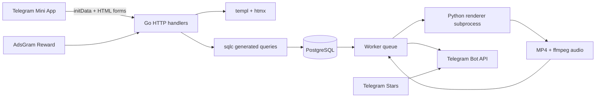

# CONTGEN

[English overview](../README.md)

> Telegram Mini App, которая превращает CSV-данные в короткие вертикальные видео с анимированными bar chart race.

[](https://go.dev/)
[](https://www.postgresql.org/)
[](https://templ.guide/)
[](https://sqlc.dev/)
[](https://github.com/smirnoffff/contgen)

CONTGEN принимает таблицу вида `year, entity, value`, позволяет выбрать визуальную тему, музыку и способ оплаты, ставит ролик в очередь и отправляет готовый MP4 отдельным сообщением от Telegram-бота.


Кадры настоящего рендера; значения языков программирования — демонстрационные данные.

## Возможности

- вертикальный рендер 1080×1920 в Python с длительностью от 3 до 60 секунд;
- четыре темы: Dark Glass, Corporate Light, Cyber HUD и Vintage Print;
- HTML-предпросмотр в Mini App и одна мобильная композиция на всех размерах экрана;
- корзина с несколькими роликами, per-user номерами заказов и понятным статусом очереди;
- два способа оплаты: Telegram Stars и Reward-реклама AdsGram;
- две рекламы на каждый ролик с восстановлением прогресса после перезагрузки Mini App;
- отправка готового MP4 напрямую в Telegram, без отдельной медиатеки внутри приложения;
- библиотека личных и общих датасетов и музыки;
- промокоды, роли администратора и панель управления;
- 20 локалей с автоматическим выбором языка Telegram, ручным переключателем и английским fallback для ещё не переведённых строк;
- PostgreSQL как источник истины для заказов, платежей и render jobs.

## Как устроен проект



Go отвечает за авторизацию Telegram, HTML-обработчики, бизнес-правила оплаты, очередь и отправку файлов. `templ` генерирует Go-компоненты из шаблонов, htmx обновляет отдельные фрагменты страницы. sqlc генерирует типизированный слой доступа к PostgreSQL из миграции и SQL-запросов. Рендерер запускается как отдельный Python subprocess: Go передаёт ему JSON с точками и темой, получает MP4, а затем при необходимости добавляет музыку через ffmpeg.

PostgreSQL хранит пользователей, датасеты, точки, музыку, корзины, заказы, платежи, промокоды и render jobs. Файлы в `data/` считаются runtime-артефактами и намеренно не попадают в Git. Заказ может содержать несколько jobs; worker берёт их с advisory lock, обновляет статусы в БД и повторяет отправку в Telegram при временной ошибке.

## Быстрый локальный запуск

Нужны Go 1.26+, PostgreSQL 14+, Python 3.14, ffmpeg и `uv`.

```sh
git clone https://github.com/smirnoffff/contgen.git
cd contgen
cp .env.example .env
```

Создай роль PostgreSQL и базу с этой ролью в качестве владельца. В `.env` укажи реальные параметры подключения и новый `SESSION_SECRET` (например, результат `openssl rand -hex 32`). Пример использует порт `5433`; при необходимости поменяй его. Приложение читает переменные окружения, поэтому сначала загрузи локальный конфиг:

```sh
set -a
. ./.env
set +a
PGPASSWORD="$DB_PASSWORD" psql \
  --host="$DB_HOST" --port="$DB_PORT" --username="$DB_USER" --dbname="$DB_NAME" \
  --set=ON_ERROR_STOP=1 --file=migrations/001_init.sql
```

Если используешь `DATABASE_URL`, примени схему через `psql "$DATABASE_URL" --set=ON_ERROR_STOP=1 --file=migrations/001_init.sql`. Затем установи Python-зависимости, сгенерируй sqlc/templ и добавь стартовый каталог:

```sh
make renderer-setup
make generate
make seed-catalog
```

Для браузерного прогона без Telegram авторизации:

```sh
DEV_LOGIN=true APP_URL=http://127.0.0.1:8080 go run ./cmd/app
```

Открой `http://127.0.0.1:8080`. Локальный вход создаёт тестового пользователя, поэтому можно проверить студию, библиотеку, корзину, очередь и симулированные Reward-рекламы. В обычном режиме `DEV_LOGIN=false` и нужен настоящий `TELEGRAM_BOT_TOKEN`.

## Запуск в Telegram на ноутбуке

Для Mini App нужен публичный HTTPS URL. Самый удобный бесплатный вариант для разработки — Tailscale Funnel: он не добавляет промежуточную страницу перед приложением.

1. Включи Funnel на локальном порту:

   ```sh
   tailscale funnel --bg http://127.0.0.1:8080
   ```

2. В `.env` укажи URL Funnel и токен бота:

   ```env
   TUNNEL_PROVIDER=tailscale
   APP_URL=https://your-device.your-tailnet.ts.net
   TELEGRAM_BOT_TOKEN=...
   SESSION_SECRET=случайная_строка_минимум_32_символа
   DEV_LOGIN=false
   ```

3. Запусти приложение вместе с проверками окружения:

   ```sh
   make run-telegram
   ```

4. В BotFather обнови **все используемые точки входа** на тот же `APP_URL`:
   - `/mybots` → бот → Bot Settings → Main Mini App — кнопка запуска в профиле;
   - `/myapps` → бот → приложение — ссылка вида `t.me/bot/app`;
   - Bot Settings → Menu Button — кнопка у строки сообщения.

   Изменение `.env` и туннеля не меняет ссылки, сохранённые в BotFather. Если появляется предупреждение ngrok, проверь URL конкретной кнопки: старые сообщения и отдельная именованная Mini App могут продолжать открывать прежний домен.

`make run-telegram` загружает `.env`, собирает приложение, проверяет PostgreSQL и `/healthz`, после чего ждёт уже работающий Funnel. Для альтернативного dev-туннеля поддерживается ngrok: выбери `TUNNEL_PROVIDER=ngrok`, закрепи HTTPS-домен в кабинете ngrok и выполни `make ngrok-login`.

Ссылка доступна, пока ноутбук включён и запущен процесс. Для постоянного адреса понадобится сервер или домен с HTTPS; приложение уже умеет работать за reverse proxy.

## Конфигурация

Скопируй `.env.example` в `.env`. Секреты, токен бота, пароль PostgreSQL и локальные файлы в Git не добавляются.

| Переменная | Назначение |
| --- | --- |
| `DB_HOST`, `DB_PORT`, `DB_USER`, `DB_PASSWORD`, `DB_NAME` | PostgreSQL |
| `DATABASE_URL` | Полный DSN, имеет приоритет над отдельными `DB_*` |
| `SERVER_HOST`, `SERVER_PORT` | Адрес Go HTTP-сервера |
| `APP_URL` | Публичный URL Mini App |
| `TELEGRAM_BOT_TOKEN` | Токен бота для авторизации, Stars и отправки MP4 |
| `SESSION_SECRET` | Подпись HttpOnly-сессии, минимум 32 символа |
| `DEV_LOGIN` | Локальный вход без Telegram; только на loopback |
| `WORKER_ENABLED` | Включение очереди рендера |
| `RENDER_SECONDS` | Длина видео от 3 до 60 секунд, по умолчанию 12 |
| `DATA_DIR` | Runtime-файлы, по умолчанию `data` |
| `ADMIN_TELEGRAM_IDS` | Telegram ID администраторов через запятую |
| `ADS_ENABLED` | Включение рекламной оплаты |
| `ADSGRAM_BLOCK_ID` | Числовой Reward block ID из AdsGram |
| `ADSGRAM_DEBUG` | Тестовый режим AdsGram, перед production выключить |

## AdsGram и Stars

Stars работает через Telegram `createInvoiceLink` и подтверждение `pre_checkout_query`/`successful_payment`. Для AdsGram создай платформу с тем же HTTPS URL, который открыт в Telegram, добавь Reward block и задай его ID в `.env`:

```env
ADS_ENABLED=true
ADSGRAM_BLOCK_ID=123456
ADSGRAM_DEBUG=true   # только Test Platform
```

В режиме разработки рекламный поток можно пройти через две симулированные рекламы. В Telegram Mini App AdsGram показывает по две Reward-рекламы на каждый ролик; сервер связывает рекламную сессию с пользователем и заказом, а после последнего просмотра переводит заказ в `PAID`.

## Генерация и тесты

```sh
make renderer-setup   # создаёт .venv и ставит Python-зависимости
make render-demo      # создаёт локальный preview.mp4 без БД
make test             # Go unit tests + Python renderer tests
make test-storage     # интеграционные тесты с TEST_DATABASE_URL
```

Изменение схемы или SQL-запроса проходит так:

1. добавь новую миграцию в `migrations/`;
2. измени запрос в `internal/storage/queries/`;
3. выполни `make generate`;
4. запусти тесты и проверь сгенерированный код.

`internal/storage/dbgen` и `*_templ.go` хранятся в репозитории для воспроизводимой сборки и не редактируются вручную.

## Структура каталогов

```text
cmd/app             HTTP-сервер, worker и Telegram payments
cmd/renderdemo      рендер без БД
cmd/renderdb        рендер из PostgreSQL
cmd/seedcatalog     идемпотентный демо-каталог
internal/web        handlers, auth, workflow и embedded assets
internal/web/views  templ templates и локализация
internal/storage    транзакции, SQL-запросы и sqlc facade
internal/worker     очередь render jobs и доставка в Telegram
internal/renderer   Go-обёртка над Python renderer
python/renderer     сцена, bar chart race и экспорт MP4
migrations          исходная схема PostgreSQL
scripts              локальный запуск Telegram-туннеля
```

## Безопасность

Telegram `initData` проверяется на сервере HMAC-SHA-256 бот-токеном, срок действия ограничен, а браузер получает подписанную HttpOnly cookie. Данные `initDataUnsafe` не используются для авторизации. Личные датасеты и заказы проверяются по пользователю из серверной сессии. Перед публикацией проверь, что `.env`, `data/`, локальные скриншоты и runtime-видео находятся в `.gitignore`.

## Статус

CONTGEN — учебный pet-проект и основа курсовой работы. Он предназначен для локального запуска и тестирования Mini App на ноутбуке; production-развёртывание требует собственного HTTPS-хоста, Telegram-настроек и рабочих ключей платёжного/рекламного провайдера.

GitHub Actions запускает Go- и Python-тесты, интеграционные тесты PostgreSQL и Gitleaks по доступной истории Git с маскировкой значений. О проблемах безопасности сообщай через [закрытый отчёт](../SECURITY.md), а не публичный issue.


## Администрирование

Укажи свой числовой Telegram ID в `ADMIN_TELEGRAM_IDS`, перезапусти сервер и открой Mini App заново. Кнопка «Управление студией» появляется только у администратора; права проверяются на сервере для каждого действия.

Сводка показывает данные за всё время. Поступления Stars считаются из успешных платежей `payments` с методом `STARS`, а не из стоимости заказов. Реклама и промокоды показываются отдельными счётчиками; это не баланс Telegram или AdsGram. Локальные аккаунты с неположительным Telegram ID исключены по умолчанию и доступны через переключатель тестовых данных.

В заказах доступны поиск по имени, username, Telegram ID и внутреннему ID заказа, фильтры статуса и страницы по 20 записей. В карточке показаны владелец, номер заказа у пользователя, внутренний ID, фактическая оплата и все ролики заказа. Неудачную генерацию можно повторить; готовый файл — скачать. В материалах доступны загрузка и публикация общей библиотеки, в пользователях — роли, в промокодах — скидки, сроки и лимиты. Истёкшие и исчерпанные промокоды отмечены отдельно от доступных.
